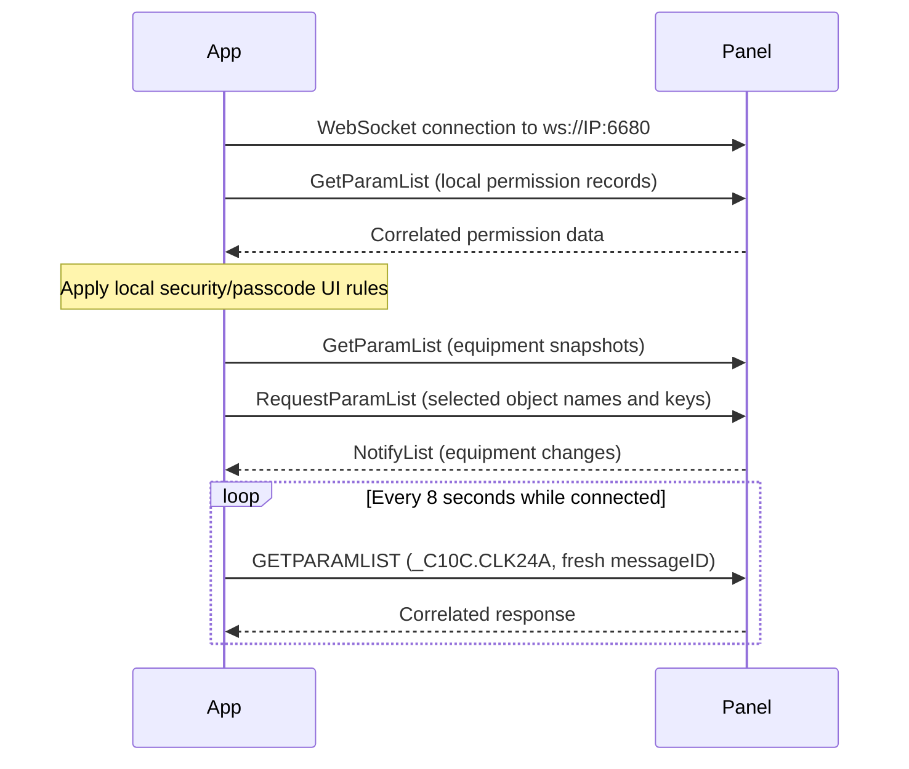

# Pentair Android App: Local IntelliCenter Protocol

Analysis date: 2026-10-20. Package: `com.pentair.pentairhome`.

This reference records static analysis of Pentair Pool 4.2.21 (build 21615),
the package linked from the Pentair Home Google Play URL. The downloaded
distribution labels it **Pentair Pool**. Its React Native Hermes bytecode was
disassembled and decompiled; Android DEX code and resources were also decoded.
The app was not executed against an IntelliCenter, and no panel commands were
sent during this investigation.

**Evidence scope:** a request builder proves the app contains that request.
It does not prove every panel accepts it, that every UI path is reachable, or
that a write completes successfully. Existing device observations remain the
authority for firmware-specific behavior. Examples below are reconstructed
from builders, not captured traffic; identifiers in angle brackets are placeholders.

## Artifact Provenance

| Item | Value |
|---|---|
| Play listing | <https://play.google.com/store/apps/details?id=com.pentair.pentairhome> |
| Download used | `https://d.apkpure.net/b/XAPK/com.pentair.pentairhome?version=latest` |
| Distribution | Third-party APKPure XAPK, arm64-v8a, English, xxxhdpi splits |
| App version | 4.2.21 / 21615, as recorded in XAPK metadata |
| Base APK size | 44,967,834 bytes |
| Hermes asset | `assets/index.android.bundle`, 22,559,264 bytes, HBC version 96 |
| XAPK SHA-256 | `9dc62be5ef606c5150ec4c31337c745f03a2c82f832bb8de91a21adc51571af3` |
| Base APK SHA-256 | `17514549c605962871c68db04a707cb5aa99a22975a411635b4336e2dd1385b1` |
| Hermes SHA-256 | `ed262bd769b4ce8ba25e3faf5594f1a7d611b4db61d6b7cddd364e61be7f4526` |

Apktool's decoded package metadata independently reports version 4.2.21 /
21615, minimum SDK 24, and target SDK 36.

The mirror's signing identity was not compared with an independently obtained
Google Play APK. These hashes identify exactly the artifact inspected, rather
than establishing publisher authenticity or current Play availability.

The working artifacts are in `/tmp/pentair-analysis` on the analysis machine;
they are temporary and are not distributed in this repository. The report's
function IDs and bytecode offsets allow findings to be reproduced from the
same Hermes asset without retaining the whole decompiled application here.

## Local Transport and Discovery

The app has distinct local and remote branches in its shared WebSocket manager.
The local branch constructs:

```text
ws://<ipAddress>:6680
```

It passes that URL to the JavaScript `WebSocket` constructor without an
additional path, access-token query, or custom authentication arguments in
this branch. The remote branch instead uses a configured cloud URL and request
query parameters. The remote connection saga supplies installation `id` and
`access-token`; these are not part of the inspected local URL constructor.

The decoded manifest references `@xml/network_security_config`; that resource
sets `base-config cleartextTrafficPermitted="true"` with system trust anchors.
The native `com.balthazargronon.RCTZeroconf.ZeroconfModule` exposes the scan
bridge and resolved-service fields `addresses`, `name`, `host`, `port`, and
`txt`, corroborating the JavaScript discovery path.

The local discovery screen calls `zeroconf.scan('http', 'tcp', 'local.')`,
corresponding to `_http._tcp.local.`. It handles resolved services and filters
names with `includes(ICTConstant.localSystemPrefix)`, whose value is `Pentair`.
One selection path uses the first resolved address when no explicit IP is
present. The shared local connector uses its configured port 6680, rather than
deriving the port from the service record in that constructor.

| App constant | Value | Interpretation |
|---|---|---|
| `scanningTimeOut` | 3000 ms | Discovery UI timing constant |
| `scanningInterval` | 10000 ms | Discovery UI timing constant |
| `scanningRefreshTimeOut` | 5000 ms | Discovery refresh timing constant |
| `webSocketTimeOut` | 15000 ms | Connection UI timeout constant |

These are app policy values, not protocol requirements. The current library
already supports both raw TCP/6681 and WebSocket/6680. Its discovery code also
browses `_pentair._tcp.local.` and probes raw TCP at the advertised WebSocket
port plus one; those behaviors are library choices and are not established by
the inspected app discovery path. An `_http._tcp` service type does not imply
that port 6681 carries HTTP.

## Connection and Message Lifecycle



This diagram combines inspected paths into a conceptual lifecycle; exact
ordering and selected equipment depend on the screen and reconnection state.

### Framing and Correlation

`sendEvent` ultimately sends `JSON.stringify(request)` through WebSocket
`send`. The inspected sender appends no CRLF. The receiver parses the event's
`data` as JSON, then dispatches nonempty messages as
`intelliCenterSocketOnMessage`, except for its own heartbeat response.
Do not infer raw TCP framing from this sender: the library's TCP transport
uses its own framing. Its WebSocket transport currently sends JSON plus CRLF;
the app demonstrates a sender without that suffix, not a compatibility test
of either choice on any particular firmware.

The request helper deep-copies templates, fills `objectList` entries with
actual `objnam` values and the supplied key template, and assigns a fresh
`messageID`. Some builders instead use fixed labels such as `HEATERS_DATA`,
`OCP_INFO`, `CONFIG_DATA`, or `SET_SYNC_MODE`. A client should correlate
responses by its own IDs and dispatch `NotifyList` separately, rather than
assuming IDs are always UUIDs or that every inbound frame answers its last write.

### Application Heartbeat

The WebSocket manager schedules `sendPing` every **8000 ms** after open.
`sendPing` assigns a UUID to `QUERY_STATUS`, sends its JSON, and starts a
**7000 ms** watchdog. The query is an application request, not a WebSocket
control-frame ping:

```json
{
  "command": "GETPARAMLIST",
  "condition": "OBJNAM=_C10C",
  "objectList": [{"objnam": "ALL", "keys": ["CLK24A"]}],
  "messageID": "<fresh-uuid>"
}
```

The query template initially sets `messageID` to the literal `activty_status`
(including that spelling); `sendPing` replaces it with a fresh UUID.
The receive handler suppresses
forwarding the message whose ID matches the current heartbeat query. The
watchdog marks the connection disconnected if its pending flag remains set;
these timings are client policy and should not be copied into the library
without evaluating its existing liveness mechanism.

### Local Security Flow

The local connection UI contains a permission discovery request for
`OBJTYP = PERMIT`, including `ENABLE`, `PASSWRD`, `SHOMNU`, and `TIMOUT`.
Response predicates compare enabled role records and the entered passcode;
the UI also contains an explicit warning for security-disabled local mode.
This establishes application-side role/passcode handling. It does not establish
which restrictions the panel itself enforces, or justify describing LAN access
as universally authenticated or universally unauthenticated.

Permission responses and broad `_5451` reads can contain credentials and
personal information. The system-info template requests contact/address/location
fields as well as equipment state. Prefer explicit operational keys when
collecting diagnostic evidence, and redact permission data from shared captures.

## Snapshot, Subscription, and Write Shapes

The app distinguishes initial reads from ongoing subscriptions:

| Operation | App command | Relevant shape |
|---|---|---|
| Snapshot | `GetParamList` / `GETPARAMLIST` | `condition`, `objectList[].objnam`, `objectList[].keys` |
| Subscribe | `RequestParamList` / `REQUESTPARAMLIST` | Concrete equipment names and selected `keys` |
| Push update | `NotifyList` | Handlers inspect returned object `params` |
| Write parameters | `SetParamList` / `SETPARAMLIST` | `objectList[].objnam`, `objectList[].params` |
| Named read | `GetQuery` | `queryName`, `arguments`, `messageID` |
| Named action | `SetCommand` | `method`, `arguments`, `messageID` |

Mixed command capitalization is present in the app. Preserve known spellings
when reproducing a builder; static analysis alone does not prove arbitrary
case normalization by every firmware.

A reconstructed body snapshot using a reduced, explicit key set:

```json
{
  "command": "GetParamList",
  "condition": "OBJTYP = BODY",
  "objectList": [{"objnam": "ALL", "keys": ["OBJTYP", "SNAME", "TEMP", "LSTTMP", "STATUS", "HTMODE"]}],
  "messageID": "<snapshot-id>"
}
```

The full body snapshot template uses a single colon-separated string inside
the `keys` array; other templates use individual strings. The example above
uses the latter style to keep the fields explicit. A corresponding
subscription is built from equipment names obtained from the snapshot:

```json
{
  "command": "RequestParamList",
  "objectList": [{"objnam": "<body-objnam>", "keys": ["TEMP", "LSTTMP", "STATUS", "HTMODE"]}],
  "messageID": "<subscription-id>"
}
```

The dashboard's `subscribeRequestParams` covers feature groups, individual
features, bodies, individual lights, light groups, chemistry, and heaters.
The manager emits `intelliCenterSubscribeParams` on a local reconnect path,
which is evidence that subscriptions need explicit restoration in that app.
`ClearParam` and `ReleaseParamList` templates also exist. Their presence alone
does not establish scope, lifetime, or the correct release sequence; do not
treat them as equipment shutdown or delay-cancellation commands.

## Equipment Fields Found in App Templates

These are client-requested fields, not an authoritative schema of supported
panel attributes. Unknown-key echoes and missing fields still require handling.

| Domain | Notable requested fields | Consequence for documentation and further work |
|---|---|---|
| Body | `TEMP`, `LSTTMP`, `LOTMP`, `HITMP`, `HTSRC`, `HTMODE`, `HEATER`, `FILTER`, `MANUAL`, `MODE` | `LSTTMP` is explicitly included in both snapshot and subscription builders; retain its distinction from live `TEMP` |
| Circuit / light | `STATUS`, `USE`, `SOURCE`, `TIME`, `TIMOUT`, `DNTSTP`, `FREEZE`, `SET`, `SWIM`, `SYNC` | Requested state includes program selection, action flags, and timer/source information, not just on/off |
| Heater | `READY`, `STATUS`, `HTMODE`, `HEATING`, `COOL`, `BOOST`, `TIME`, `DLY`, `START`, `STOP`, `BODY` | A requested `DLY` field does not establish transient delay activity |
| Chemistry | `PHVAL`, `ORPVAL`, `SINDEX`, `PHTNK`, `ORPTNK`, `ALK`, `CALC`, `CYACID`, `SUPER`, `SALT`, `PUMP`, `TIME`, `STATE` | App subscription coverage is broader than basic pH/ORP readings |
| Sensor | `OBJTYP`, `STATUS`, `PROBE`, `CALIB`, `SOURCE` | `_A135` is hard-coded in an air-sensor template; do not generalize it to every sensor |
| System | `SERVICE`, `VER`, `MODE`, `AVAIL`, `VALVE`, `HEATING`, `UPDATE`, `IN`, `PROGRESS`, `AUTO` | Separate operating state, delay configuration, and firmware-update fields |
| FDR/FDP event object | `_FDR`: `EVENTSTATUS`, `EVENTID` | Snapshot/subscription templates exist; dashboard handlers feed a separate scheduled-event workflow, not firmware-update progress |

The light snapshot condition recognizes `LITSHO`, `LIGHT`, `GLOBRITE`, `GLOW`,
`SAML`, `INTELLI`, `COLORWL`, `CLRCASC`, `MAGIC2`, `DIMMER`, and `GLOWT`.
This is a useful inventory for compatibility investigation, not proof that
all these subtypes share the same program list or group-action semantics.

## Feature and Temperature Controls

The dashboard contains concrete operational writers in addition to query
templates. Each targets a selected object's `objnam` with `SetParamList`:

| Interaction | Constructed `params` | Evidence |
|---|---|---|
| Toggle a feature | `STATUS: ON` or `STATUS: OFF` from the boolean input; optional extra parameters are merged | Function 79538 |
| Adjust cooling setpoint | `HITMP` set to the input converted to a string | Function 79552 |
| Adjust heating setpoint | `LOTMP` set to the input converted to a string | Function 79556 |
| Select temperature mode | `HTMODE: "9"` for cooling, `"1"` for heating, initialized to `"0"` otherwise | Function 79558 |

The setpoint/mode handlers update the app model locally and use delayed send
helpers. Optimistic display changes are therefore not device acknowledgements.
The cooling handler also tracks pending values and a 3000 ms timeout path.
These UI mechanisms explain why a screen update and the eventual wire request
may not occur at exactly the same time.

A feature-toggle request reconstructed with a placeholder ID:

```json
{
  "command": "SetParamList",
  "objectList": [{"objnam": "<feature-objnam>", "params": {"STATUS": "ON"}}],
  "messageID": "<toggle-message-id>"
}
```

These mappings describe the inspected handlers. Temperature bounds, valid
modes for a particular heater, and interlocks still depend on equipment and
firmware; this is not a universal mode enumeration.

## Light-Group Actions

Three inspected handlers build a `SetParamList` request for the selected
`lightData.objnam` and set **one** parameter to `ON`:

| UI action handler | Parameters | App message ID |
|---|---|---|
| Function 80713 | `{"SET":"ON"}` | `SET_SET_MODE` |
| Function 80714 | `{"SYNC":"ON"}` | `SET_SYNC_MODE` |
| Function 80715 | `{"SWIM":"ON"}` | `SET_SWIM_MODE` |

For example, the Sync builder is:

```json
{
  "command": "SetParamList",
  "objectList": [{"objnam": "<selected-light-objnam>", "params": {"SYNC": "ON"}}],
  "messageID": "SET_SYNC_MODE"
}
```

The dashboard also has a normalization helper that sets incoming
`params.SET`, `params.SYNC`, and `params.SWIM` to `OFF` in its local object.
This is **client model manipulation**, not evidence that the panel emitted
an `OFF` notification or completed an action. A successful write response,
app UI state, and observed physical completion are distinct facts.

These findings support the known action payload family but do not expand
the library's evidence-bounded Color Sync firmware/topology support, or prove
Color Set/Swim completion, concurrency, or restoration behavior.

## Additional Named Operations

The inspected IntelliCenter modules contain these query/action templates:

| Command | Name | Evidence / interpretation |
|---|---|---|
| `GetQuery` | `GetConfiguration` | `CONFIG_DATA` template; configuration read |
| `GetQuery` | `GetCircuitTypes` | Empty-string `arguments` template |
| `GetQuery` | `GetRemotes` | Remote-controller inventory template |
| `GetQuery` | `GetStatusMessageFlags` | Alert configuration read, not demonstrated active-status data |
| `SetCommand` | `SetStatusMessageFlags` | Alert configuration write; exact argument population needs separate tracing |
| `SetCommand` | `CreateObjectAffect` | Equipment association builder uses `arguments.OBJNAM` and `arguments.objectList` |
| `SetCommand` | `CreateGroup` / `EditGroup` | Builders contain `OBJLIST`, `SNAME`, `TIME`; configuration varies between light and feature groups |
| `SetCommand` | `DeleteObject` | Equipment deletion template |
| `SetCommand` | `DeleteRemote` | Remote-controller deletion template |

Firmware update builders write `_5451.IN` as `YES` (install) or `NO`
(decline), and subscribe to `VER`, `PROPNAME`, `UPDATE`, `IN`, `PROGRESS`,
and `AUTO`. This identifies a configuration/action surface; no update was
initiated, and no update-state interpretation was validated here.

The schedule templates include `CREATEOBJECT` for `SCHED`, `VACFLO`,
`VACTIM`, `START`, and `STOP`, and a deletion write using `STATUS: DSTROY`.
These are configuration operations and should not be replayed as read probes.

## Additional Capability Tracing

The [integration capability audit](https://github.com/joyfulhouse/intellicenter/blob/main/docs/pentair-app-capability-audit.md)
compares these paths with current HA functionality and distinguishes implemented
app code, conditional availability, and unresolved leads.

- **History:** function 83343 (`0x013e4025`) defines `ReadHistoryMessage`
  with string `timeStart` and `timeEnd` fields. Functions 83255/83287 replace
  the template dates, 83261 sends through the shared manager, and 83258 handles
  response `objectList` data. Local availability, retention, and series schema
  have not been established by a panel session.
- **FDR/FDP events:** function 79486 (`0x01335c53`) reads `EVENTSTATUS` and
  `EVENTID`, compares status with `running`, and updates dashboard event state.
  Function 79485 (`0x01335b45`) opens scheduled-event details. Function 79651
  derives the enable gate from `featureConfigReducer.cecConfig.isEnable`.
  This corrects the earlier classification of `_FDR` as a firmware event object.
- **Hybrid purifier:** function 80684 (`0x0136f413`) reads
  `featureFlagsReducer.hyp1.itelliblueEnabled` into `shouldShowHypScreens`.
  Functions 83937/83939 build chemistry-object create/edit operations with
  `BODY`, `PUMP`, and `TIME`. Associated pump `OPSTATE` is interpreted by
  protected/bypass/purifying helpers. Setup also uses Bluetooth/registration
  paths; not all provisioning is established as local.
- **General configuration:** function 83088 (`0x013d5f00`) assembles sensor
  `CALIB`, clock, timezone/DST, manual-priority, persistent delay, and solar-relay
  changes. The solar-relay UI is conditional on firmware and equipment topology.
- **Alert metadata:** function 83477 (`0x013e9c7d`) exports schema/CDN
  compatibility and configurable/critical-alert helpers, with a supported
  schema-version array containing `1.0`. Metadata loading and offline behavior
  remain to be traced.

## System Delay Investigation: What Remains Unresolved

No distinct transient delay-cancel operation was identified in the inspected
local builders. Literal searches of the disassembly did not find
`GetActiveStatusMessages`, `CancelDelay`, or `CancelSystemDelay`.
That is bounded negative evidence, not proof that the panel lacks those
operations: firmware features can exist without an app literal, or be reached
through a different build, screen, generated name, or command surface.

`GetStatusMessageFlags` is a newly documented lead for **alert settings**.
Its name does not establish that it returns current delay activity. Existing
device evidence that heater/valve `DLY` and `_5451.HEATING` / `_5451.VALVE`
are configuration must not be overturned by their appearance in request keys.
This app analysis therefore does not resolve the active-delay sensor schema
or justify implementing a cancel button using persistent settings.

## Reproducing the Analysis

See [APK reverse-engineering workflow](APK_REVERSE_ENGINEERING.md) for pinned
tool setup, artifact checks, function extraction, and interpretation pitfalls.

Work outside the source tree. Obtain a matching artifact, verify its hashes,
and use `unzip` to extract the base APK and Hermes asset. The successful
download above was a third-party mirror; the `.com` binary endpoint returned
a web challenge during this session. A response named `.xapk` is not sufficient:
validate it as a ZIP before proceeding.

Tools used:

- JADX 1.5.3 for DEX-to-Java analysis. The full run completed with 17 reported
  decompilation errors; the Hermes findings do not depend on those Java methods.
- Apktool 3.0.3 for Android manifest/resources, with `-s`
  to skip smali generation.
- [P1sec/hermes-dec](https://github.com/P1sec/hermes-dec), commit
  `2e796663e1fedb93dca51060797ebf3327b3fedb`, for Hermes disassembly and
  decompilation. Decompiled output is pseudocode, not runnable JavaScript.

```sh
unzip app.xapk -d bundle
unzip -p bundle/com.pentair.pentairhome.apk assets/index.android.bundle > index.android.bundle
sha256sum bundle/com.pentair.pentairhome.apk index.android.bundle
python3 hermes-dec/hbc-disassembler index.android.bundle app.hasm
python3 hermes-dec/hbc-decompiler index.android.bundle app.js
jadx --no-res -d java bundle/com.pentair.pentairhome.apk
java -jar apktool.jar d -s -o decoded bundle/com.pentair.pentairhome.apk
rg -n --max-columns 1000 --max-columns-preview 'RequestParamList|NotifyList|GetStatusMessageFlags' app.hasm
```

Keep searches narrow: this bundle also embeds SDKs, translations, other Pentair
device protocols, and large image literals. A matching string without its
containing function and call path is not sufficient evidence for IntelliCenter.

## Evidence Index

Offsets identify function starts in the hashed Hermes asset. Instruction
offsets are relative to those starts. IDs and offsets are build-specific.

| Finding | Function ID / bytecode offset | Useful instruction or detail |
|---|---|---|
| Local URL constants | 49574 / `0x00efd77d` | `0x66`: `ws://`; `0x6f`: `6680` |
| Local vs remote constructor | 60063 / `0x0102c183` | `0xcb` onward: local URL branch |
| Heartbeat and watchdog | 60065 / `0x0102c2f2` | UUID, `QUERY_STATUS`, 7000 ms |
| Open and resubscription | 60068 / `0x0102c433` | 8000 ms interval; local subscribe event |
| Receive and heartbeat suppression | 60069 / `0x0102c65e` | JSON parse and message-ID comparison |
| JSON sender | 60072 / `0x0102c8b5`, 60073 / `0x0102c9e2` | Delayed send via `JSON.stringify` |
| Discovery constants | 78974 / `0x0131db39` | `0x257d`: `ICTConstant` object |
| Discovery scan | 79387 / `0x01319c6f` | `http`, `tcp`, `local.` |
| Resolved-service filter | 79390 / `0x0133152d` | Name includes `localSystemPrefix` |
| Local connect flow | 79292 / `0x0132c255` | `isLocal`, IP, connect, permission request |
| Permission response predicates | 79305 / `0x0132c92c`, 79306 / `0x0132c963` | Enabled roles and passcode comparison |
| Query/subscription templates | 79341 / `0x0132ed4b` | Body, heater, sensor, chemistry, firmware, configuration |
| Heartbeat query construction | 79341 / `0x0132ed4b` | `0x5d4`: clock query; `0xcd3`: copy with message-ID label `activty_status` |
| Subscription object expansion | 79036 / `0x013251cb`, 79037 / `0x01325241` | Clone template, replace object names, message ID |
| Dashboard subscriptions | 79647 / `0x0133c34a` | Eight equipment categories |
| Local action-flag normalization | 79501 / `0x0133698a`, 79502 / `0x013369f7` | Model updates to `OFF` |
| Feature toggle | 79538 / `0x01338bae` | Boolean input maps to `STATUS: ON/OFF` |
| Cooling setpoint | 79552 / `0x01339249` | String-valued `HITMP` |
| Heating setpoint | 79556 / `0x01339572` | String-valued `LOTMP` |
| Temperature mode | 79558 / `0x013396e8` | Cooling 9, heating 1, otherwise initialized to 0 |
| Color Set builder | 80713 / `0x013705ec` | Single-object `SET: ON` write |
| Color Sync builder | 80714 / `0x0137068c` | Single-object `SYNC: ON` write |
| Color Swim builder | 80715 / `0x0137071d` | Single-object `SWIM: ON` write |
| Remote inventory/deletion templates | 82555 / `0x013bc229` | `GetRemotes`, `DeleteRemote` |
| Alert flag templates | 83391 / `0x013e57ae` | `GetStatusMessageFlags`, `SetStatusMessageFlags` |
| Remote credential parameters | 84324 / `0x0140d104` | Installation ID and access token in remote path |

## Implications for This Library

Implementation and research are tracked in
[intellicenter #188](https://github.com/joyfulhouse/intellicenter/issues/188),
which links library issues #99 through #107 and the HA feature requests.
These documentation findings do not mark those implementation issues complete.

The current dual transport, object model, and explicit subscriptions fit the
app's local protocol family. No production behavior was changed by this work.
Useful follow-up investigations are the `_FDR` event schema, alert flag
arguments, additional light subtypes, and reconnect subscription behavior on
specific firmware. Each needs correlated device responses before becoming a
capability guarantee. App timer values, model resets, and request-key lists
should not become protocol requirements solely because the official client
contains them.
